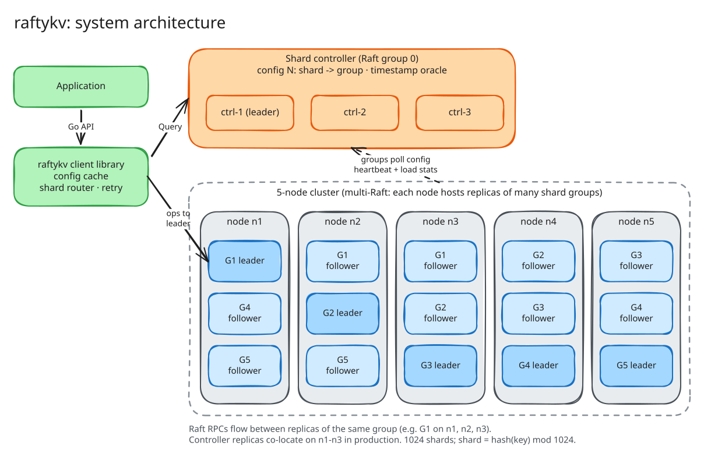

# raftykv

A sharded, linearizable key-value store in Go. Each shard group uses Raft for replication.

> **Status: M1 (Raft core) in progress.** Sprints S0 (foundation) and S1 (leader election, PreVote, CheckQuorum) are done. Log replication is next. The full design is in [`docs/DESIGN.md`](docs/DESIGN.md); the sections below describe the target system.

## Development

Requires Go 1.26+. The race detector needs cgo (on Windows: a MinGW `gcc` on `PATH`).

| Command | Action |
|---|---|
| `make test` | Run all tests |
| `make race` | Run all tests with the race detector |
| `make importlint` | Check the determinism boundary (raft/kv code MUST NOT import `time`, `net`, `os`, `math/rand`) |
| `make proto` | Lint `.proto` files and regenerate Go code (buf is pinned in `go.mod`; no `protoc` install needed) |
| `make ci` | Run the CI checks locally |



## Goals

| Goal | Target |
|---|---|
| Correctness | Linearizable reads and writes. The Porcupine checker finds 0 violations in 10,000 seeded runs with random partitions, crashes, and restarts. |
| Elasticity | Shards move between groups while the cluster serves traffic. Log compaction and snapshots keep disk use bounded. |
| Performance | ≥ 52,000 ops/s at p99 < 10 ms on a 5-node cluster (workload in [DESIGN §12](docs/DESIGN.md#12-performance-plan)). |

## Core design

- **Raft from scratch.** PreVote, CheckQuorum, pipelined replication, joint consensus, and leadership transfer. The Raft core does no I/O.
- **Multi-Raft.** 1024 hash shards. Each node hosts replicas of many shard groups.
- **Shard controller.** A dedicated Raft group stores the shard → group config.
- **Exactly-once writes.** Each write carries a client ID and a sequence number. Duplicate writes return the stored result.
- **Reads.** ReadIndex by default. Lease reads and follower reads are opt-in.
- **Snapshots.** One snapshot per shard, made by copy-on-write. Followers that fall behind receive the snapshot in chunks, and the transfer can resume.
- **Shard migration.** The receiving group pulls the shard data. The sender deletes the data only after the receiver confirms through its own Raft log.

## Distinguishing features

| ID | Feature |
|---|---|
| F1 | **Deterministic simulation testing.** One seed replays a full failure run. |
| F2 | **Online linearizability audit.** Porcupine checks a sample of live traffic in production. |
| F3 | **Cross-shard transactions.** Two-phase commit in the style of Percolator. |
| F4 | **Witness replicas.** These replicas vote but keep no state machine. They use about 33% less storage. |
| F5 | **Load-aware rebalance.** The controller moves hot shards. |
| F6 | **Watch streams.** Clients receive changes in commit order and can resume after a reconnect. |
| F7 | **Fault-injection CLI.** Use the same fault schedules on a live staging cluster and in the simulator. |

## Planned API

| Operation | Meaning |
|---|---|
| `Get(key)` | Linearizable read |
| `Put(key, value)` | Linearizable write |
| `Delete(key)` | Linearizable delete |
| `CAS(key, revision, value)` | Write only if the revision matches |
| `Scan(start, end, limit)` | Range read for each shard |
| `Watch(key \| prefix, fromRevision)` | Event stream (F6) |
| `Txn(ops[])` | Atomic multi-key transaction (F3) |

## Planned repository layout

```
cmd/          raftykv-server, raftykv-ctl, raftykv-bench
raft/         Raft core, WAL, snapshots, transport
kv/           state machine: B-tree, MVCC, dedup
shardctrl/    shard controller and rebalancer
shardkv/      shard group server and migration
client/       smart client library
txn/          cross-shard transactions
sim/          deterministic simulator
linearize/    Porcupine harness and audit service
chaos/        fault schedule format
docs/         design document and diagrams
```

## Milestones

| ID | Scope |
|---|---|
| M1 | Raft core and WAL |
| M2 | Single-group KV store and Porcupine harness |
| M3 | Snapshots and log compaction |
| M4 | Shard controller and shard migration |
| M5 | Deterministic simulator (F1) and online audit (F2) |
| M6 | Performance work to reach the 52K ops/s target |
| M7 | Features F3–F7 |

## Documentation

- [Design document](docs/DESIGN.md)
- Diagrams: [`docs/diagrams/`](docs/diagrams/). The `.excalidraw` files are the editable sources. Open them at [excalidraw.com](https://excalidraw.com).
