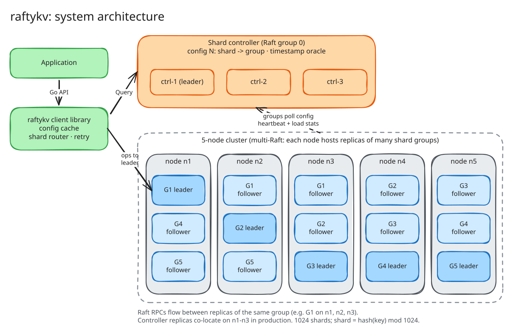
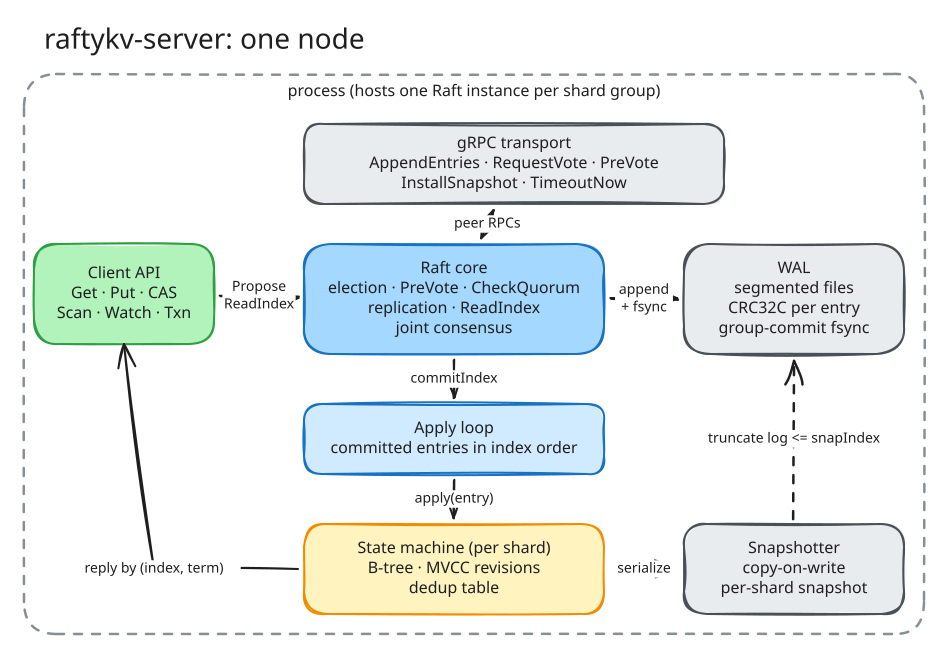
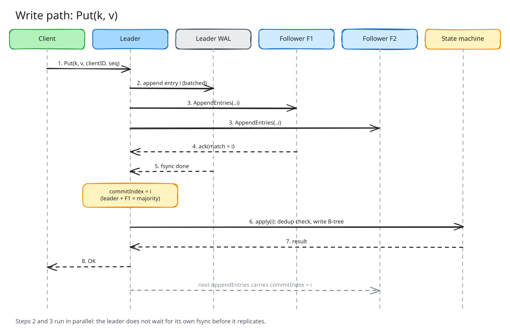
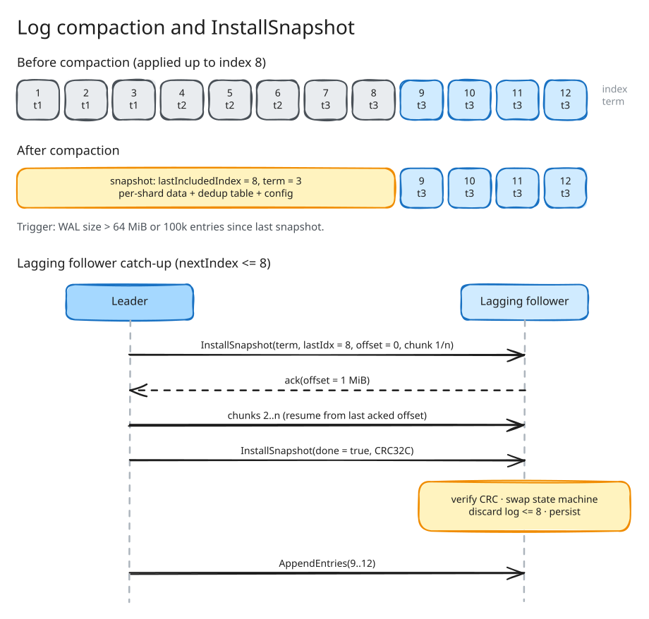
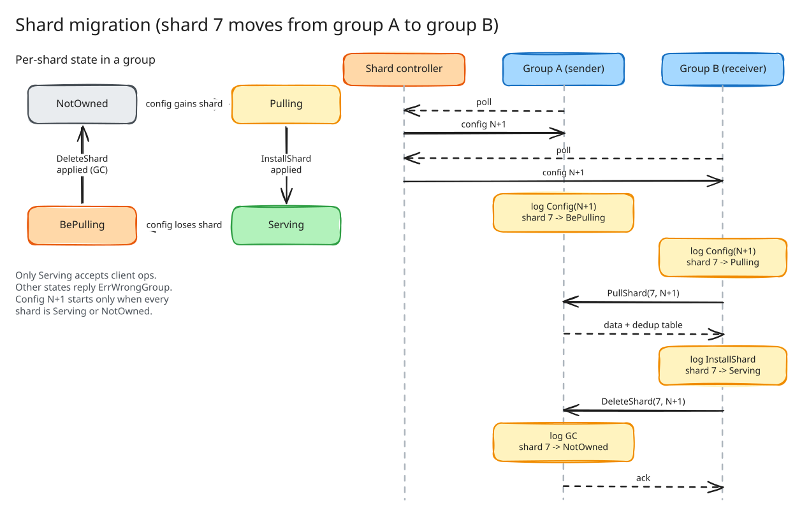
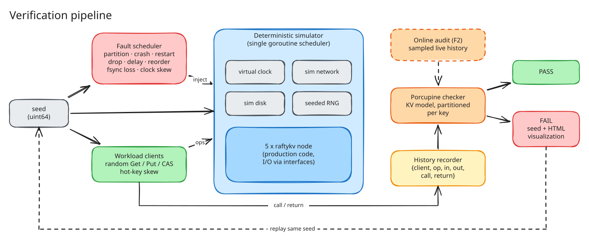

# raftykv — Design Document

| Field | Value |
|---|---|
| Status | Draft v0.1 |
| Date | 2026-11-06 |
| Language | Go 1.23+ |
| Owner | srrfrhmn |

> **Style note.** This document uses an ASD-STE100-inspired style: short sentences, active voice, one meaning for each term. Requirement words follow RFC 2119: **MUST**, **SHOULD**, **MAY**.

---

## 1. Summary

raftykv is a sharded key-value store. It gives linearizable reads and writes. Each shard group uses the Raft consensus algorithm. raftykv implements Raft from the start; it does not use `etcd/raft` or `hashicorp/raft`.

Three headline claims:

1. **Correct.** The Porcupine checker finds zero linearizability violations under random partitions, crashes, and restarts.
2. **Elastic.** Shards move between groups while the cluster serves traffic. Log compaction and snapshots keep disk use bounded.
3. **Fast.** A 5-node cluster serves at least 52,000 ops/s with p99 latency below 10 ms (workload in §12).

raftykv also adds seven features that most Raft key-value stores do not have (§9). The two most important are deterministic simulation testing and an online linearizability audit.

---

## 2. Goals and non-goals

### 2.1 Requirements

| ID | Requirement | Acceptance criterion |
|---|---|---|
| R1 | All client operations on one key MUST be linearizable. | Porcupine reports 0 violations in 10,000 seeded simulation runs. |
| R2 | Each write MUST apply exactly one time, also when the client retries. | A test with forced retries shows no duplicate effects. |
| R3 | The cluster MUST stay available when a minority of each group fails. | With 1 of 3 replicas down, throughput stays ≥ 80% of baseline. |
| R4 | Log size MUST stay bounded. | WAL size stays below 2 × snapshot threshold in a 24 h soak test. |
| R5 | A shard MUST move to a new group without loss of data or of linearizability. | Porcupine passes during continuous shard moves. |
| R6 | A 5-node cluster SHOULD serve ≥ 52K ops/s at p99 < 10 ms. | `raftykv-bench` result on the reference hardware (§12). |
| R7 | A failed test run MUST be reproducible from one seed. | Same seed gives byte-identical event trace. |
| R8 | Operators SHOULD see correctness and performance health live. | Metrics in §13 are exported. |

### 2.2 Non-goals

- Byzantine fault tolerance.
- Multi-region deployment with geo-aware placement (v1).
- SQL or secondary indexes.
- Values larger than 1 MiB.
- Storage larger than the RAM of a node (v1 state machine is in memory; see §16).

---

## 3. Glossary

| Term | Definition |
|---|---|
| **Node** | One `raftykv-server` process on one host. |
| **Shard** | A unit of key space. `shard = fnv64a(key) mod 1024`. |
| **Shard group** | A Raft group of 3 or 5 replicas that owns a set of shards. |
| **Replica** | One member of a shard group on one node. |
| **Shard controller** | A special Raft group (group 0). It stores configs. |
| **Config** | A numbered map from shard to shard group, plus group membership. |
| **Term** | A Raft election period. It increases monotonically. |
| **Index** | The position of an entry in the Raft log. |
| **Commit index** | The highest index that a majority stores. |
| **Snapshot** | A serialized state-machine image at one index. |
| **Witness** | A voting replica that stores the log but has no state machine (§9.4). |
| **Revision** | A global, per-shard, monotonic counter. Each write increments it. |
| **Seed** | A 64-bit value. It fixes all random choices in a simulation run. |
| **History** | A list of client operations with call time and return time. |

---

## 4. System architecture



*Source: [`diagrams/architecture.excalidraw`](diagrams/architecture.excalidraw)*

### 4.1 Components

| Component | Responsibility |
|---|---|
| **Client library** | Caches the current config. Maps key → shard → group. Sends each request to the group leader. Retries on `ErrWrongGroup` or `ErrWrongLeader`. |
| **Shard controller** | Raft group 0 on 3 nodes. Stores the config history. Accepts `Join`, `Leave`, `Move`, `Query`. Runs the rebalancer (§9.5) and the timestamp oracle (§9.3). |
| **Shard group** | Raft group that owns a set of shards. Serves client operations for these shards. Moves shards in and out (§8). |
| **Node** | Hosts replicas of many groups (multi-Raft). Shares one transport, one WAL directory, and one tick loop across groups. |

### 4.2 Placement

- Each node hosts replicas of many groups. The default is 5 groups × 3 replicas on 5 nodes.
- Leaders spread across nodes. The controller moves leadership with `TimeoutNow` to keep balance.
- Controller replicas co-locate with shard-group replicas on nodes n1–n3.

### 4.3 Config change rule

A shard group applies configs in strict order: N, N+1, N+2. A group starts config N+1 only when every shard is in state `Serving` or `NotOwned` (§8).

---

## 5. Raft core



*Source: [`diagrams/raft-node.excalidraw`](diagrams/raft-node.excalidraw)*

### 5.1 Design rules

- The Raft core is a pure state machine. It takes inputs (`Tick`, `Step(msg)`, `Propose`) and returns a `Ready` struct (entries to persist, messages to send, entries to apply).
- The core does no I/O. A driver goroutine does I/O. This rule enables deterministic simulation (§9.1).
- All time comes from ticks, not from the wall clock.

### 5.2 Election

| Mechanism | Purpose |
|---|---|
| Randomized election timeout (10–20 ticks, 1 tick = 10 ms) | Prevents split votes. |
| **PreVote** | A candidate asks for votes before it increments its term. A partitioned node cannot disrupt the cluster when it returns. |
| **CheckQuorum** | A leader steps down if it does not hear from a majority in one election timeout. |
| **Leadership transfer** (`TimeoutNow`) | Moves the leader for balance or for a planned restart. |

### 5.3 Replication

- **Pipelining.** The leader sends AppendEntries before earlier ones return. Max in-flight messages per follower: 256.
- **Batching.** The leader merges proposals that arrive in one tick into one entry batch.
- **Parallel fsync.** The leader sends entries to followers and writes its own WAL at the same time. The leader counts itself in the quorum only after its fsync completes.
- **Fast backtrack.** A follower rejects with `(conflictTerm, firstIndexOfTerm)`. The leader skips one full term per round trip.
- **Flow control.** A follower in `Probe` state gets one message per heartbeat. A follower in `Replicate` state gets the full pipeline.

### 5.4 Persistence (WAL)

| Property | Value |
|---|---|
| Layout | Segmented files, 64 MiB each, one directory per node. |
| Record | `len (u32) · crc32c (u32) · type (u8) · payload` |
| Durability | Group commit: one `fsync` per batch for all groups on a node. |
| Hard state | `term`, `vote`, `commit` written with each batch. |
| Recovery | Read segments in order. Stop at the first bad CRC. Truncate the tail. |

### 5.5 Membership change

raftykv uses **joint consensus**. A config change goes through `C_old,new` and then `C_new`. During `C_old,new`, a decision needs a majority of both sets. Single-server changes are not used, because joint consensus also supports witness swaps (§9.4).

---

## 6. State machine and client semantics



*Source: [`diagrams/write-path.excalidraw`](diagrams/write-path.excalidraw)*

### 6.1 Storage

- One in-memory B-tree (`google/btree`, degree 32) for each shard.
- Each key stores `(value, createRevision, modRevision, version)`.
- MVCC keeps old versions for 5 minutes or until compaction. Watch (§9.6) and transactions (§9.3) use them.

### 6.2 Exactly-once writes

1. The client attaches `(clientID, seq)` to each write. `seq` increments by 1 per write.
2. The state machine stores the last `seq` and the last result for each `clientID`.
3. If an entry has `seq ≤ lastSeq`, the state machine returns the stored result. It does not apply the entry again.
4. The dedup table is part of each shard snapshot. It moves with the shard during migration.
5. Entries for idle clients expire after 1 hour. The expiry time comes from the log entry, not from the local clock.

### 6.3 Reads

| Mode | Mechanism | Cost | Default |
|---|---|---|---|
| **ReadIndex** | Leader records commit index, confirms leadership with one heartbeat round, waits for apply ≥ that index, then reads. | 1 RTT, no disk write | Yes |
| **Lease read** | Leader reads locally while its lease is valid. Lease = election timeout − max clock drift (default drift bound 50 ms). | 0 RTT | Opt-in |
| **Follower read** | Follower asks the leader for the read index, waits for local apply, then reads. | 1 RTT to leader | Opt-in per request |

Lease reads depend on bounded clock drift. The documentation MUST state this risk. The simulator tests lease reads with clock skew inside and outside the bound.

### 6.4 Write path

1. Client sends `Put(k, v, clientID, seq)` to the leader of the shard's group.
2. Leader checks that it owns the shard in state `Serving`. If not, it returns `ErrWrongGroup`.
3. Leader appends the entry to its batch and to its WAL.
4. Leader sends AppendEntries to followers in parallel.
5. When a majority stores the entry, the leader advances the commit index.
6. The apply loop applies the entry. The state machine does the dedup check and writes the B-tree.
7. The leader replies to the client. A reply waits on a channel keyed by `(index, term)`. If the term at that index changed, the reply is `ErrWrongLeader`.

---

## 7. Log compaction and snapshots



*Source: [`diagrams/snapshot-compaction.excalidraw`](diagrams/snapshot-compaction.excalidraw)*

### 7.1 Trigger

A group takes a snapshot when one of these conditions is true:

- WAL size for the group is more than 64 MiB.
- More than 100,000 entries were applied since the last snapshot.

### 7.2 Snapshot content

- One file **per shard**, not one file per group. Migration (§8) sends the same file format.
- Each file contains: B-tree data, MVCC history in retention, dedup table, `lastIncludedIndex`, `lastIncludedTerm`, config number, CRC32C.

### 7.3 Procedure

1. The apply loop marks the snapshot index `S`.
2. The state machine makes a copy-on-write clone of each B-tree (`btree.Clone`, O(1)).
3. A background goroutine serializes the clones to temporary files.
4. The goroutine calls `fsync` on each file, then renames it into place atomically.
5. The Raft core discards log entries with index ≤ `S`. The WAL deletes whole segments below `S`.

The apply loop does not stop during steps 3–5.

### 7.4 InstallSnapshot

- The leader sends a snapshot when a follower needs an entry that the log no longer has.
- The leader sends the snapshot in 1 MiB chunks. Each chunk has an offset.
- The follower acknowledges each chunk. After a leader change or a reconnect, the transfer resumes from the last acknowledged offset.
- The follower checks the CRC, replaces its state machine, discards its log up to `lastIncludedIndex`, and persists the new state.
- A rate limit (default 64 MiB/s per node) protects foreground traffic.

---

## 8. Shard migration



*Source: [`diagrams/shard-migration.excalidraw`](diagrams/shard-migration.excalidraw)*

### 8.1 Shard states

| State | Meaning | Client operations |
|---|---|---|
| `Serving` | The group owns the shard and has its data. | Accepted |
| `Pulling` | The new config gives the shard to this group. The data has not arrived. | `ErrWrongGroup` |
| `BePulling` | The new config removes the shard. Another group must fetch the data. | `ErrWrongGroup` |
| `NotOwned` | The group does not own the shard. | `ErrWrongGroup` |

### 8.2 Procedure (shard 7 moves from group A to group B)

1. The controller commits config N+1. Shard 7 now maps to group B.
2. The leaders of A and B poll the controller every 100 ms. Each leader proposes `Config(N+1)` to its own log.
3. A applies `Config(N+1)`. Shard 7 goes to `BePulling`.
4. B applies `Config(N+1)`. Shard 7 goes to `Pulling`.
5. The leader of B sends `PullShard(7, N+1)` to A.
6. A returns the shard data and dedup table only if A has applied config N+1.
7. The leader of B proposes `InstallShard(7, N+1, data)`. When B applies it, shard 7 goes to `Serving`.
8. The leader of B sends `DeleteShard(7, N+1)` to A.
9. The leader of A proposes `GC(7, N+1)`. When A applies it, shard 7 goes to `NotOwned` and A frees the data.
10. A returns `ack`. B stops the retry loop for this shard.

### 8.3 Safety rules

- All state changes go through the Raft log of the group. Only the leader sends migration RPCs.
- Every migration RPC carries the config number. A group rejects an RPC with an old config number.
- A group never deletes shard data before the receiver confirms through its own Raft log.
- Shard moves for unrelated shards run in parallel. A group stays `Serving` for all other shards.

### 8.4 Availability during migration

Only the moving shard is unavailable. The window is typically one pull round trip plus one Raft commit. The target is p99 < 200 ms for a 64 MiB shard on a 10 Gbit/s network.

---

## 9. Distinguishing features

| ID | Feature | Phase |
|---|---|---|
| F1 | Deterministic simulation testing | Core (M5) |
| F2 | Online linearizability audit | Core (M5) |
| F3 | Cross-shard transactions | M7 |
| F4 | Witness replicas | M7 |
| F5 | Load-aware split and rebalance | M7 |
| F6 | Linearizable Watch streams | M7 |
| F7 | Fault-injection control API | M7 |

### 9.1 F1 — Deterministic simulation testing

**What.** The full cluster runs in one OS thread under a simulator. A seed controls all scheduling, message delivery, disk behavior, and faults. The same seed gives the same run, byte for byte.

**Design.**

- All I/O goes through interfaces: `Clock`, `Transport`, `Disk`, `Rand`. Production code gets real implementations. The simulator gets simulated implementations.
- The simulator uses a discrete event queue ordered by `(virtualTime, seq)`.
- `go vet`-style lint rule: packages under `raft/`, `kv/`, `shardkv/` MUST NOT import `time`, `net`, `os`, or `math/rand` directly.
- The simulated disk can lose unsynced writes on crash, corrupt a tail record, and return `EIO`.

**Value.** A failing seed in CI becomes a reproducible bug report. Developers replay the seed with full trace logs.

**Risk.** Goroutines in production code break determinism. Mitigation: the driver is the only goroutine per group in simulation mode; a determinism test runs each seed twice and compares traces.

### 9.2 F2 — Online linearizability audit

**What.** Production nodes sample a small part of client traffic, record its history, and check it with Porcupine in the background.

**Design.**

1. The client library tags 0.1% of keys (hash-based sample) for audit.
2. For audited keys, the client records `{op, input, output, callTime, returnTime}` with a hybrid logical clock.
3. Clients stream records to an audit service. The service groups records by key into windows of 10 s.
4. The service runs Porcupine on each window with a 2 s timeout per key.
5. The service exports `raftykv_linearizability_violations_total` and stores the failing history as an HTML visualization.

**Value.** raftykv checks its own correctness in production, not only in tests.

**Risk.** Clock uncertainty between clients can produce false positives. Mitigation: widen each operation interval by the HLC uncertainty bound; report "inconclusive" when the check times out.

### 9.3 F3 — Cross-shard transactions

**What.** `Txn` gives atomic, serializable multi-key writes across shard groups.

**Design.** Percolator-style two-phase commit.

1. Client gets `startTS` from the timestamp oracle in the shard controller. The oracle hands out ranges of 1,000 timestamps per leader lease to cut controller load.
2. Client picks one key as the **primary**. Client writes a lock + value at `startTS` to every key (prewrite). Each write is one Raft entry in the owning group.
3. If a prewrite finds a newer write or a lock, the transaction aborts.
4. Client gets `commitTS`. Client commits the primary first. The primary commit is the commit point.
5. Client commits secondaries asynchronously. A reader that finds a secondary lock checks the primary to resolve it.

**Risk.** Lock contention on hot keys. Mitigation: wound-wait on conflict; a lock TTL of 3 s; a resolver in each group cleans expired locks.

### 9.4 F4 — Witness replicas

**What.** A witness is a voting replica that stores the log but applies nothing. It never becomes leader.

**Design.**

- A witness grants votes and acknowledges AppendEntries. It rejects `TimeoutNow`.
- A witness discards log entries after the leader reports them as applied on a majority of full replicas.
- A group of 2 full replicas + 1 witness tolerates 1 failure, like a 3-replica group.
- If a full replica fails, the controller promotes a new full replica with joint consensus. It does not promote the witness.

**Value.** About 33% less storage and memory than 3 full replicas.

**Risk.** With one full replica down, only one copy of the state machine exists. Mitigation: the controller treats this state as urgent and repairs it first.

### 9.5 F5 — Load-aware split and rebalance

**What.** The controller moves and splits shards based on measured load.

**Design.**

- Each group leader reports per-shard QPS, bytes, and p99 latency in the config poll (§8.2).
- The controller computes a load score per group: `0.6 × QPS share + 0.4 × bytes share`.
- The max score can stay above 1.25 × mean for 60 s. Then the controller moves the hottest shard of the hottest group to the coolest group.
- If one shard has more than 40% of its group's QPS, the controller splits it. raftykv uses 1024 fixed hash shards in v1; a split moves the shard to a dedicated group. Range splits are a v2 item.
- The controller allows at most 2 concurrent moves per cluster.

### 9.6 F6 — Linearizable Watch streams

**What.** A client subscribes to a key or a prefix from a revision. It receives every change in commit order.

**Design.**

- Each shard keeps an in-memory event ring of the last 100,000 changes, indexed by revision.
- `Watch(key|prefix, fromRevision)` returns a stream. If `fromRevision` is older than the ring, the server returns `ErrCompacted` and the client must re-read.
- A prefix watch that spans many shards opens one stream per shard. The client merges streams and gives a per-shard order. The API documents that order across shards is not global.
- After a reconnect, the client resumes from the last received revision + 1. No event is lost or repeated.

### 9.7 F7 — Fault-injection control API

**What.** Operators inject faults into a live staging cluster. The fault language is the same as in the simulator.

**Design.**

- `raftykv-ctl chaos partition --groups "n1,n2|n3,n4,n5" --for 30s`
- `raftykv-ctl chaos crash n3 --restart-after 10s`
- `raftykv-ctl chaos delay n2 --p50 20ms --p99 200ms --for 60s`
- `raftykv-ctl chaos run schedule.yaml` replays a schedule file. The simulator uses the same file format.
- The transport layer applies network faults. The server MUST start with `--enable-chaos`; production builds reject chaos commands by default.

---

## 10. Network and API

### 10.1 Transport

- gRPC over HTTP/2 with protobuf messages.
- One connection between each pair of nodes. Messages for all groups share it. Each message carries `groupID`.
- Heartbeats for all groups between two nodes merge into one message per tick ("heartbeat coalescing").

### 10.2 Client operations

| Operation | Semantics |
|---|---|
| `Get(key)` | Linearizable read (ReadIndex by default). |
| `Put(key, value)` | Linearizable write. Returns new revision. |
| `Delete(key)` | Linearizable delete. |
| `CAS(key, expectedRevision, value)` | Writes only if `modRevision` matches. |
| `Scan(start, end, limit)` | Per-shard linearizable range read. Not atomic across shards in v1. |
| `Watch(key \| prefix, fromRevision)` | Event stream (F6). |
| `Txn(ops[])` | Atomic multi-key transaction (F3). |

### 10.3 Error codes

| Code | Meaning | Client action |
|---|---|---|
| `OK` | Success. | — |
| `ErrNoKey` | Key not found. | Return to caller. |
| `ErrWrongLeader` | This replica is not the leader. Response includes a leader hint. | Retry at hint. |
| `ErrWrongGroup` | This group does not serve the shard now. | Refresh config, retry. |
| `ErrTimeout` | No commit inside the deadline. Result is unknown. | Retry with same `seq`. |
| `ErrCompacted` | Requested revision is no longer kept. | Re-read, then watch again. |
| `ErrTxnConflict` | Transaction aborted. | Retry with new `startTS`. |

---

## 11. Verification strategy



*Source: [`diagrams/verification.excalidraw`](diagrams/verification.excalidraw)*

### 11.1 Test layers

| Layer | Scope | Tool |
|---|---|---|
| Unit | Raft core state transitions, WAL encode/decode, B-tree, dedup. | `go test`, table tests |
| Property | Raft safety invariants after each step: Election Safety, Log Matching, Leader Completeness, State Machine Safety. | Simulator with invariant hooks |
| Linearizability | Client histories under faults. | Porcupine |
| Fuzz | WAL recovery from random byte corruption. Protobuf decode. | `go test -fuzz` |
| Soak | 24 h run with chaos schedule on real nodes. | F7 + `raftykv-bench` |

### 11.2 Porcupine harness

1. Workload clients run random `Get`, `Put`, `Append`, and `CAS` operations on a small key set (10 keys) to raise contention.
2. The recorder stores `{clientID, op, input, output, callTime, returnTime}` for each operation.
3. An operation with result `ErrTimeout` has unknown outcome. The recorder sets its return time to infinity. Porcupine treats it as concurrent with all later operations.
4. The KV model uses `Partition` by key. Porcupine checks each key independently.
5. On failure, the harness writes an HTML visualization and the seed.

### 11.3 Fault schedule

| Fault | Parameters |
|---|---|
| Network partition | Random 2-way or 3-way split; also "bridge" (one node sees both sides). |
| Node crash | Stop process; lose unsynced disk writes. |
| Restart | Restart after random delay 0–5 s. |
| Message fault | Drop 0–20%, delay 0–500 ms, reorder, duplicate. |
| Disk fault | Torn tail write, `EIO` on fsync, slow fsync (100 ms). |
| Clock skew | ±0–200 ms per node (affects lease reads only). |
| Config churn | `Join`, `Leave`, `Move` every 1–5 s during the run. |

### 11.4 Release gate

- 0 violations in 10,000 seeded runs, each with 30 s of virtual time.
- 0 invariant failures.
- All seeds that failed in the past run again in each CI build (regression corpus).

---

## 12. Performance plan

### 12.1 Target workload

| Parameter | Value |
|---|---|
| Nodes | 5 (8 vCPU, 32 GiB RAM, NVMe SSD, 10 Gbit/s) |
| Groups | 5 groups × 3 replicas |
| Shards | 1024 |
| Mix | 50% `Get`, 50% `Put` |
| Key / value size | 16 B / 128 B |
| Key distribution | Uniform; second run with Zipf θ = 0.99 |
| Clients | 256 concurrent, closed loop |
| Target | ≥ 52,000 ops/s; p99 < 10 ms |

### 12.2 Techniques

| Technique | Expected effect |
|---|---|
| Proposal batching per tick | Fewer Raft entries and fsyncs. |
| Pipelined AppendEntries | Removes stop-and-wait per follower. |
| Parallel leader fsync and replication | Removes one disk latency from the commit path. |
| Group commit across groups | One fsync per node per batch. |
| ReadIndex batching | One heartbeat round confirms many reads. |
| Async apply loop | Replication does not wait for apply. |
| Heartbeat coalescing | Less traffic with many groups. |
| Buffer pools (`sync.Pool`) for messages | Lower GC pressure. |

### 12.3 Benchmark tool

`raftykv-bench` reports throughput, p50/p99/p999 latency, CPU per node, fsync/s, and bytes on the network. It writes a JSON result file. CI compares each result with the last baseline and fails on a regression of more than 10%.

---

## 13. Observability

| Area | Metrics (Prometheus) |
|---|---|
| Raft | `raft_term`, `raft_commit_index`, `raft_apply_lag`, `raft_leader_changes_total`, `raft_append_latency_seconds` |
| WAL | `wal_fsync_seconds`, `wal_bytes`, `wal_segments` |
| Snapshot | `snapshot_duration_seconds`, `snapshot_bytes`, `install_snapshot_total` |
| Shards | `shard_state{shard,state}`, `shard_qps`, `migration_duration_seconds` |
| Client | `kv_ops_total{op,code}`, `kv_latency_seconds{op}` |
| Audit (F2) | `linearizability_checks_total`, `linearizability_violations_total`, `linearizability_inconclusive_total` |

- Logs use `log/slog` in JSON. Each line has `node`, `group`, `term`, `index`.
- `GET /debug/groups` returns the status of each local replica.
- `raftykv-ctl status` prints the cluster view.

---

## 14. Repository layout

```
raftykv/
├── cmd/
│   ├── raftykv-server/     # node binary
│   ├── raftykv-ctl/        # admin + chaos CLI (F7)
│   └── raftykv-bench/      # load generator
├── api/proto/              # protobuf + gRPC definitions
├── raft/                   # Raft core (pure, no I/O)
│   ├── wal/                # segmented WAL
│   ├── snapshot/           # snapshot files + InstallSnapshot
│   └── transport/          # gRPC transport, heartbeat coalescing
├── kv/                     # state machine: B-tree, MVCC, dedup, watch ring
├── shardctrl/              # shard controller, rebalancer (F5), TSO (F3)
├── shardkv/                # shard group server, migration
├── txn/                    # Percolator client + lock resolver (F3)
├── client/                 # smart client library
├── sim/                    # deterministic simulator (F1)
├── linearize/              # Porcupine models + harness + audit service (F2)
├── chaos/                  # fault schedule format (shared by F1 and F7)
└── docs/
    ├── DESIGN.md
    └── diagrams/
```

---

## 15. Milestones

| ID | Scope | Exit criterion |
|---|---|---|
| M1 | Raft core: election, PreVote, CheckQuorum, replication, WAL. | Safety invariants hold in unit + randomized tests. |
| M2 | Single-group KV, dedup, ReadIndex, Porcupine harness. | 0 violations under partitions and crashes. |
| M3 | Snapshots, log compaction, InstallSnapshot. | R4 holds in a 1 h soak. |
| M4 | Shard controller, multi-Raft node, shard migration. | R5 holds with continuous config churn. |
| M5 | Deterministic simulator (F1), online audit (F2). | R7 holds; 10,000-seed gate passes. |
| M6 | Performance work. | R6 holds on reference hardware. |
| M7 | F3–F7. | Each feature has Porcupine coverage and docs. |

---

## 16. Risks and open questions

| Risk | Impact | Mitigation |
|---|---|---|
| In-memory state machine limits data size to RAM. | Medium | v2: replace B-tree with Pebble behind the same interface. |
| Determinism breaks when a developer adds a goroutine or `time.Now`. | High | Import lint rule; double-run determinism test in CI. |
| Lease reads are unsafe with large clock drift. | High | Off by default; drift bound in config; simulator tests skew. |
| 52K ops/s target depends on hardware and fsync latency. | Medium | Publish hardware spec with each result; measure on reference hardware. |
| Porcupine check time grows with history length. | Medium | Partition by key; limit window size; timeout → "inconclusive". |
| Percolator locks add latency on hot keys. | Medium | Wound-wait; lock TTL; recommend single-shard ops for hot keys. |
| Witness reduces state-machine copies during a failure. | Medium | Repair priority in controller; alert on single-copy state. |

**Open questions**

1. Use a hybrid logical clock for MVCC timestamps, or the controller oracle only?
2. Support range sharding (v2) for efficient `Scan`, or keep hash sharding?
3. Make `Scan` atomic across shards with a transaction snapshot read?
